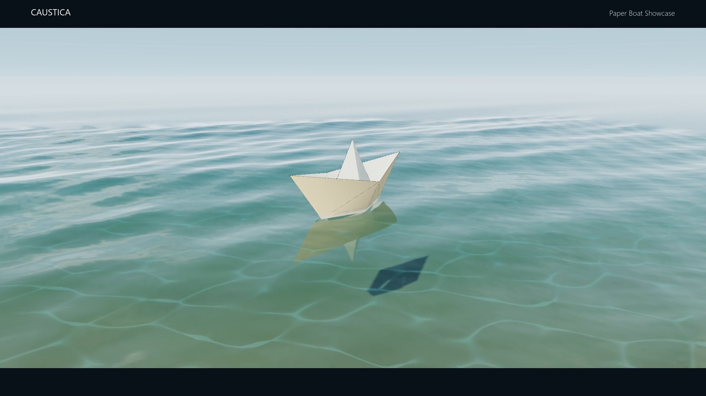

  

<h1 align="center">Caustica</h1>

Procedural water, responsive ripples, and buoyant bodies for Unity.

<strong>Unity 2022.3 · Built-in Render Pipeline · Personal-project preview</strong>

  <a href="https://github.com/samsharmabisht/Caustica/releases/tag/v0.1.0-preview">Download release</a> ·
  <a href="INSTALLATION.md">Setup guide</a> ·
  <a href="COMPATIBILITY.md">Compatibility</a> ·
  <a href="LICENSE">Personal project license</a>

Caustica combines a procedural ocean surface with interactive wave fields, sampled buoyancy, geometry reflections, underwater absorption, and procedural caustics. The included paper boat scene demonstrates how a floating body meets the water, moves under Rigidbody forces, and generates continuous surface disturbances.

**Made by samxwayout.** This repository distributes the Unity package, setup documentation, and showcase media. Editable C# and shader source files are included inside the package.

## Get started

1. Download [Caustica.unitypackage](Caustica.unitypackage?raw=true), or choose an asset from [Releases](https://github.com/samsharmabisht/Caustica/releases).
2. Import it into a Unity **Built-in Render Pipeline** project.
3. Choose **Water Physics → Open Paper Boat Showcase** and press Play.
4. To add water to your own scene, choose **Water Physics → Create Water in Current Scene**, then **Validate Current Setup**.

For the exact environment used during validation, use **Unity 2022.3.62f3 on Windows with Direct3D 11**. See [compatibility and limits](COMPATIBILITY.md) before using a different editor, pipeline, or platform.

## What is included

| System | Included behaviour |
| --- | --- |
| Procedural surface | Seeded Gerstner waves, generated geometry, capillary detail, and quality presets |
| Interactive ripples | Moving fine and broad fields, propagation, interference, and body/particle contact |
| Buoyancy | Collider sampling, density-based lift, damping, and a configurable centre of mass |
| Reflections and depth | Planar geometry reflections, depth-aware refraction, and underwater absorption |
| Caustics | Procedural refractive concentration on submerged, depth-writing geometry |
| Paper boat | Origami model, two-sided paper material, fold details, buoyant hull, and optional autopilot |
| Inspector controls | Editable curves for lift, thrust, steering, drag, wake strength, cruise speed, and camera easing |

### Four focused examples

- **Water Physics Only** — water, camera, and sunlight.
- **Caustics Preview** — a submerged sand receiver.
- **Interaction Lab** — floating bodies, pointer disturbances, and particle rain.
- **Paper Boat Showcase** — a moving boat and four-shot cinematic camera loop.

## Showcase

[Download the 32-second, 1080p showcase video](https://github.com/samsharmabisht/Caustica/releases/download/v0.1.0-preview/Caustica-PaperBoat-Showcase-1080p.mp4).

The silent film uses frames rendered from the included Unity scene. Fixed-rate 30 fps playback is not a real-time performance benchmark.

## Validation

The preparation build passed physics, ripple propagation, surface-contact, particle-impact, reflection, and caustic checks. A fresh package import built all four scenes into a Windows player with **0 build errors and 0 warnings**. The player also ran without script or shader exceptions during a short runtime check.

The response-curve checks verified that changing thrust changes actual motion and changing lift changes actual flotation. These checks establish the tested behaviour; they do not certify every hull shape or arbitrary curve configuration.

## Status and license

**This is a preview release.** Rendering integrations for URP/HDRP, cross-version certification, mobile, and VR remain future work. Bug reports with a small reproduction scene are welcome; see [contributing](CONTRIBUTING.md).

Caustica uses the custom [Caustica Personal Project License](LICENSE): personal noncommercial projects are permitted, source credit must remain, and commercial use or standalone asset redistribution requires written permission. This is a public distribution repository, not an unrestricted open-source license.

For permissions, contact [samsharmabisht](https://github.com/samsharmabisht) through the contact information on the profile. Please do not post private contact or account details in public issues.
